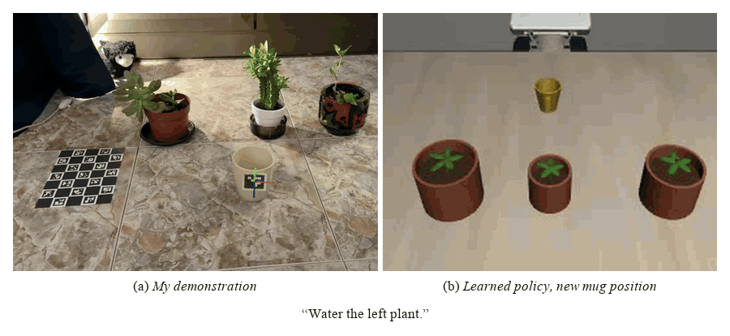
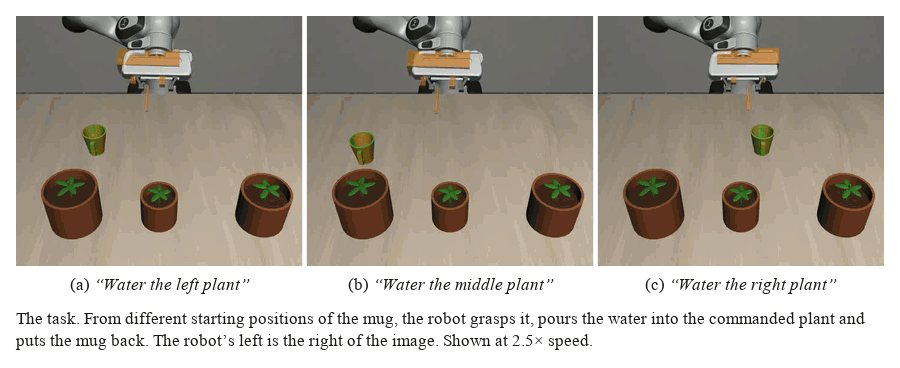
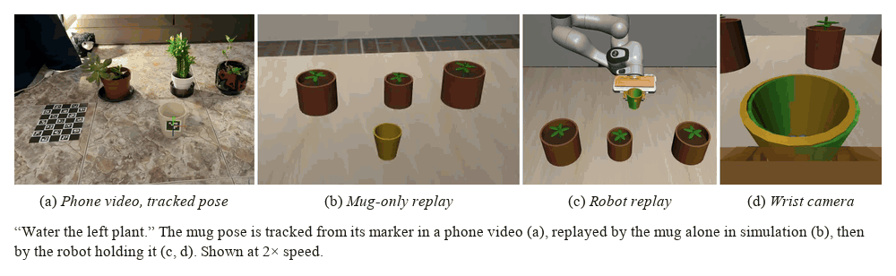
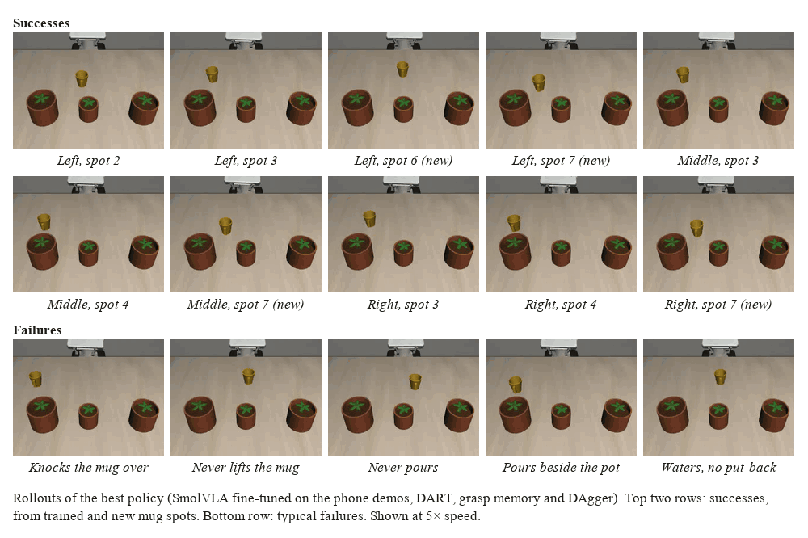

# Smart pouring: 48 phone videos → a robot that waters plants


- **How far can a handful of phone videos take a robot?** 
- **How do we make a VLA remember past information?**




▶️ **[Video walkthrough (TODO min)](TODO)** · 📹 [Raw videos](https://huggingface.co/datasets/edgarcancinoe/water_pour_videos) · 📦 [Dataset](https://huggingface.co/datasets/edgarcancinoe/water_pour) · 🤖 [Best model](https://huggingface.co/edgarcancinoe/smolvla_water_libero-4s-dart-full-xxl-sd-rel-b64-dagger1) · 🗂️ [Collection](https://huggingface.co/collections/edgarcancinoe/smart-pouring-6ad14d90214376f367e0a6f8) · 📓 [Journal](JOURNAL.md) · 📊 [Experiment tracker](TODO-public-link)

## TL;DR

<!-- 4–6 bullets max. The whole project for someone who reads nothing else. -->

- **Task:** "Water the < *left* / *middle* / *right*> plant" in a custom LIBERO scene (mug + 10 water droplets + 3 pots).
- **Data:** 48 phone recordings of me pouring (3 plants × 4 mug spots × 4 reps). An ArUco marker on the mug gives its 6-D pose → simulated replays → LeRobot dataset.
- **Policy:** SmolVLA fine-tuned on those replays + recovery data (DART, DAgger) and grasp memory so it can put the mug bac in its starting position.
- **Results** fine-tuning from the Libero [SmolVLA checkpoint](XXX):
     - **xx%** successful grasps (in and out of training distirbution)
     - **xx%** successful watering (xx% success conditioned on grasping)
     - **xx%** end-to-end success (x% success conditioned on watering)

## The task

| Step | The robot must | Success criteria |
|---|---|---|
| 1. *Grasp* | pick up the mug from a known or unknown position | the mug rises 3 cm off the table |
| 2. *Water* | pour into the commanded plant | > 50% of the 10 droplets land in that pot |
| 3. *Place back* | put the mug back at its **initial position** | mug stands, released, within 3 cm of where it started |

An episode succeeds if all three steps are completed.

<!-- One figure of the scene from agentview, pots + 8 mug spots labelled (1–4 trained, 5–8 new). -->



## 1. From phone video to training data

<!-- The "creativity" section: my recordings must visibly drive everything. Keep it to the pipeline + one GIF per stage.
     Details live in dataset/README.md. -->

```
video ─▶ mug pose ─▶ robot grabs + follows the path ─▶ LeRobot dataset
```

| Stage | Technique |
|---|---|
| Track | ChArUco (camera pose) + ArUco on mug → $(x, y, z, q)$ per frame |
| Robot replay | grasp the mug, then the hand follows the tracked mug path at a fixed grip |
| [Export](https://huggingface.co/datasets/edgarcancinoe/water_pour) | 20 fps · 2 views · $s = [\;x, y, z, \;\;r_x, r_y, r_z, \;\; f_1, f_2\;]$ · $a = [\Delta x, \Delta y, \Delta z, \Delta r_x, \Delta r_y, \Delta r_z, g]$ |



Human data gives pouring trajectory. Reach and release are scripted.

> **Main challenge:** $\;\;$ Pours tilt the mug past the arm joint limits.
> **Solution:** $\quad\qquad\;$ For each clip, pick the flattest hand tilt (35° → 40° → 50° below horizontal) that keeps joints under their limits.

> **Final base dataset: 47/48 replays that succeed**
> 

---

## 2. Implementation Journey

### [▸] Learning to grasp

The simplest implementation struggled to even pick up the mug.

| Method | Episodes | In distribution | Out of distribution | Issue |
|---|:---:|---|---|---|
| Raw replays | 47 | `███░░░░░░░` 27% | `██░░░░░░░░` 15% | Memorizes the 4 mug spots it saw |
| + **Mug shifted** ±3 cm | 175 | `████████░░` 75% | `███████░░░` 68% | No recovery from small errors |
| + **DART** recoveries | 845 | `█████████░` 85% | `███████░░░` 65% | Higher success at trained spots |
| + **State dropout** (30%) | 845 | `█████████░` **90%** | `█████████░` **80%** | — |

> **Current watering performance**: $\;$ Once grasped, **74%** trained / **46%** new spots (52% of all trials).
**Current end-to-end success**:  $\quad$ Given watering: **18%** trained, **0%** new (6% overall).


### [▸] Enabling Memory to SmolVLA

**Problem:** once the mug is lifted, the policy has forgotten where it came from, so it can't put it back.

| Memory | Put back (in distribution) |
|---|---|
| None | `█░░░░░░░░░` 5/60 |
| VLM cache of first frame fed to action expert | `██░░░░░░░░` 9/60 |
| **Include grasp offset in the state**: $(x - x_g,\ y - y_g)$ -- policy can drive it to $0$! ;) | `████░░░░░░` **25/60** |

> **Takeaway:** An explicit grasp offset (which converges to 0 in put-back) beats a learned image memory.

### [▸] Making executions more robust: Recovering from errors


As with grasping, DART noise is added to the **whole execution** (reach, carry, pour and put-back), fading to zero at the pour position so the water still lands in the plant.

Following the spirit of **HG-DAgger**, the trained policy is then rolled out in simulation. Whenever it drifts from the closest demonstration, a **teacher** takes over and steers it back. These takeovers are recorded and used to post-train the policy.

## 3. Final Results

```
SmolVLA + Shifted Dataset + Relative Pick-Up Position + DART + DAgger
```
| Shifted mug | State dropout | DART | Grasp memory | DAgger | Grasp | Water | Success |
|:---:|:---:|:---:|:---:|:---:|:---:|:---:|:---:|
| | | | | | 27% / 15% | 0% / 0% | 0% / 0% |
| ✓ | | | | | 82% / 60% | 40% / 12% | 0% / 0% |
| ✓ | ✓ | | | | 73% / 50% | 33% / 17% | 5% / 0% |
| ✓ | ✓ | reach | | | 82% / 73% | 55% / 28% | 8% / 0% |
| ✓ | ✓ | reach | ✓ | | 78% / 75% | 67% / 17% | 42% / 2% |
| ✓ | ✓ | full | ✓ | | 78% / 63% | 60% / 27% | 42% / 12% |
| ✓ | ✓ | full | ✓ | ✓ | **98% / 95%** | **82% / 58%** | **68% / 35%** |

<sub>In / out of distribution (trained / new mug spots), 60 trials each. The policy re-plans every 10 control steps (0.5 s); 60 s per trial. Untuned SmolVLA-LIBERO: 0% success.</sub>

> **How each model is evaluated:** $\;$ 3 plants × 8 mug spots (4 recorded, 4 new, 7–10 cm away) × 5 trials = 120 trials, the mug placed within ±1 cm of its spot. Every model gets the same trials (fixed seeds).
> **Settings:** $\qquad\qquad\qquad\quad\;\;$ `N_ACTION_STEPS=10` (re-plan every 0.5 s), `MAX_STEPS=1200` (60 s) and `SEED=0` by default. Each is an environment variable for `./run eval`, and each setting writes to its own `results/` folder.


# So... from 48 phone recordings:
- The robot picks up the mug almost every time
- Waters the commanded plant in **TODO** of trials
- Puts the mug back in **TODO**


 **TODO**

#### Visualization

<!-- 3–6 GIFs, one per plant, at least one at a new spot. Short (<5 s), small (<3 MB each). -->



## Run it

```bash
git clone https://github.com/edgarcancinoe/smart-pouring.git && cd smart-pouring
uv sync
```

| Step | Command | Runs on |
|---|---|---|
| Phone video → robot runs | `./run track` · `./run robot` · `./run export` | Mac |
| Recovery data | `./run dart` · `./run dagger` | CPU |
| Train | `./run train <model>` | GPU |
| Evaluate | `./run relative-eval <model> --jobs 8` | GPU + CPU |
| Compare | `./run compare` | Mac |
| Watch a policy | `./run eval-watch` | Mac |

The processed datasets and every model are on the [Hub](https://huggingface.co/edgarcancinoe). The raw phone videos (48 recordings + lens calibration) are on the Hub too: [water_pour_videos](https://huggingface.co/datasets/edgarcancinoe/water_pour_videos).

## Repo map

| Folder | What |
|---|---|
| `dataset/` | phone video → mug pose → robot runs → LeRobot dataset |
| `sim/watering/` | the LIBERO scene: pots, droplets, success check |
| [`smolvla-finetune/`](smolvla-finetune/README.md) | training, eval protocol, plots |
| `smolvla-recoveries/` | [DART](smolvla-recoveries/DART/README.md) · [DAgger](smolvla-recoveries/DAgger/README.md) |
| `smolvla-memory/` | [grasp position](smolvla-memory/grasp-position/README.md) · [relative](smolvla-memory/relative-actions/README.md) · [VLM cache](smolvla-memory/VLM-cache/README.md) |
| [`JOURNAL.md`](JOURNAL.md) | day-by-day log, every dead end |

### Model names

Each part of a name is one ingredient, e.g. `libero-4s-dart-full-xxl-sd-rel-b64-dagger1`:

| Part | Meaning |
|---|---|
| `libero` / `base` | starts from `smolvla_libero` (Panda) / `smolvla_base` |
| `4s` | 4 demos per plant × spot, + 3 shifted replays each (±3 cm) |
| `dart` · `xl` · `xxl` | DART replays per recording: 2 · 16 · 32 |
| `full` | DART pushes during the whole task, not only the reach |
| `anchor` | the shifted pours stay over the plant |
| `sd` | state dropout (30%) |
| `rel` · `gp` · `mem` | memory: relative grasp · grasp position · VLM cache |
| `b64` | batch 64 (else 32) |
| `dagger1` | + one DAgger round |
| `@15000` | the checkpoint at step 15k |
