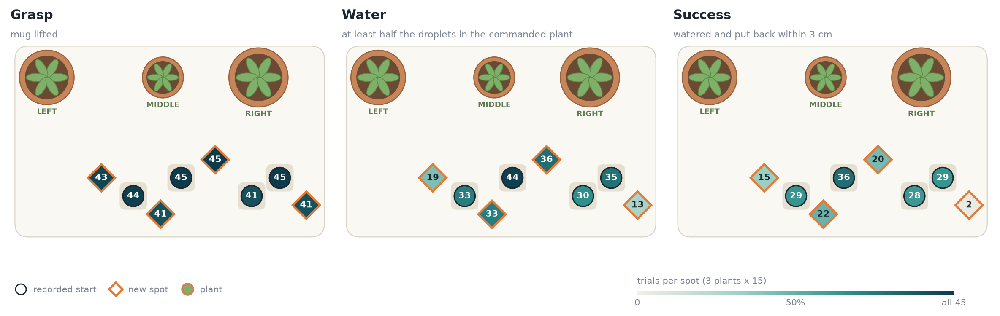

# Smart Pouring: teaching a robot to water plants from 48 phone videos of my hands

<p align="center"><b>How far can a handful of phone videos take a robot? And how do we make a VLA remember past information?</b></p>

<p align="center"><i>Spoiler: the robot learns to grasp the mug and pour... but forgets where it picked the mug up. Two numbers of memory fix that.</i></p>

<p align="center">
   <b><a href="https://www.youtube.com/watch?v=8vDlrYa82Xw">Video</a></b> &nbsp;&nbsp;|&nbsp;&nbsp;
   <a href="https://huggingface.co/edgarcancinoe/smolvla_water_libero-4s-dart-full-xxl-sd-rel-b64-dagger1">Best model</a> &nbsp;&nbsp;|&nbsp;&nbsp;
   <a href="https://huggingface.co/collections/edgarcancinoe/smart-pouring-6ad14d90214376f367e0a6f8">Videos, datasets & results</a> &nbsp;&nbsp;|&nbsp;&nbsp;
   <a href="https://edgarcancinoe.github.io/projects/smart_pouring/experiments.html">Experiment tracker</a>
</p>

<p align="center">
  
</p>

## TL;DR

<!-- 4–6 bullets max. The whole project for someone who reads nothing else. -->

- **Task:** "Water the < *left* / *middle* / *right*> plant" in a custom LIBERO scene (mug + 10 water droplets + 3 pots).
- **Data:** 48 phone recordings of me pouring (3 plants × 4 mug spots × 4 reps). An ArUco marker on the mug gives its 6-D pose → simulated replays → LeRobot dataset.
- **Policy:** SmolVLA fine-tuned on those replays + recovery data (DART, DAgger) and grasp memory so it can put the mug back in its starting position.
- **Results** fine-tuning from the Libero [SmolVLA checkpoint](https://huggingface.co/HuggingFaceVLA/smolvla_libero) (360 trials: 3 seeds, 90 s):
     - **96%** successful grasps (97% trained / 94% new mug spots)
     - **68%** successful watering (70% conditioned on grasping)
     - **50%** end-to-end success (74% conditioned on watering)

## The task

| Step | The robot must | Success criteria |
|---|---|---|
| 1. *Grasp* | pick up the mug from a known or unknown position | the mug rises 3 cm off the table |
| 2. *Water* | pour into the commanded plant | ≥ 50% of the 10 droplets land in that pot |
| 3. *Place back* | put the mug back at its **initial position** | mug stands, released, within 3 cm of where it started |

An episode succeeds if all three steps are completed.

**Pot spots:**
The pots stay fixed; only the mug moves.

**Mug spots:**
Recorded pours from **4 mug spots** (3 plants × 4 spots × 4 repetitions = 48 videos). To test spatial generalization, evaluation adds **4 new spots**, 7–10 cm away from the training spots. 

The map in [Visualization](#visualization) shows all spots and the final model's performance.

<!-- One figure of the scene from agentview, pots + 8 mug spots labelled (1–4 trained, 5–8 new). -->


## 1. From phone video to training data

<!-- The "creativity" section: my recordings must visibly drive everything. Keep it to the pipeline + one GIF per stage.
     Details live in dataset/README.md. -->

```
video ─▶ mug pose ─▶ robot grabs + follows the path ─▶ LeRobot dataset
```

| Stage | Technique |
|---|---|
| Track | ChArUco (camera pose) + ArUco on mug → $(x, y, z, q)$ per frame |
| Robot replay | grasp the mug, then the hand follows the tracked mug path at a fixed grip |
| [Export](https://huggingface.co/datasets/edgarcancinoe/water_pour) | 20 fps · 2 views · $s = [x, y, z, r_x, r_y, r_z, f_1, f_2]$ · $a = [\Delta x, \Delta y, \Delta z, \Delta r_x, \Delta r_y, \Delta r_z, g]$ |


Human data gives pouring trajectory. Reach and release are scripted.

> **Main challenge:** Pours tilt the mug past the arm joint limits.\
> **Solution:** For each clip, pick the flattest hand tilt (35° → 40° → 50° below horizontal) that keeps joints under their limits.

> **Final base dataset: 47/48 replays that succeed**
> 

---

## 2. Implementation Journey

### [▸] Learning to grasp

The simplest implementation struggled to even pick up the mug.

| Method | Episodes | In distribution | Out of distribution | Issue |
|---|:---:|---|---|---|
| Raw replays | 47 | `███░░░░░░░` 27% | `██░░░░░░░░` 15% | Memorizes the 4 mug spots it saw |
| + **Mug shifted** ±3 cm | 175 | `████████░░` 75% | `███████░░░` 68% | No recovery from small errors |
| + **DART** recoveries | 845 | `█████████░` 85% | `███████░░░` 65% | Higher success at trained spots |
| + **State dropout** (30%) | 845 | `█████████░` **90%** | `█████████░` **80%** | — |

> **Current watering performance**: Once grasped, **74%** trained / **46%** new spots (52% of all trials).\
> **Current end-to-end success**: Given watering: **18%** trained, **0%** new (6% overall).


### [▸] Enabling Memory to SmolVLA


**Problem:** SmolVLA only sees the present. Once the mug is lifted, it no longer knows where the mug came from, so it can't put it back.
**Ideas:** Store information about the mug's position, and feed it to the action expert.

| Strategy | Put back after watering (in distribution) |
|---|:---:|
| None | `██░░░░░░░░` 15% (5/33) |
| VLM cache of first frame fed to action expert | `███░░░░░░░` 31% (9/29) |
| **Include grasp offset in the state**: $(x - x_g, y - y_g)$ — policy can drive it towards $0$ ! ;) | `██████░░░░` **63% (25/40)** |


> **Final memory design:** The explicit grasp offset beat a learned image memory. The new state $s$ includes then:
>- Position relative to a detected grasp spot: $x - x_g$, $y - y_g$
>- Flag that switches to $1$ once the grasp is detected: $h \in \lbrace 0, 1 \rbrace$
>
> **Final state representation**
> ```math
> s = [\;\underbrace{x,\ y,\ z}_{\text{gripper position}},\quad \underbrace{r_x,\ r_y,\ r_z}_{\text{gripper rotation}},\quad \underbrace{f_1,\ f_2}_{\text{fingers}},\quad \underbrace{h,\ x - x_g,\ y - y_g}_{\text{grasp memory}}\;]
> ```


### [▸] Making executions more robust: Recovering from errors

The policy was still unreliable over the whole execution: small errors or underconfident behavior after the grasp would make the pour or put-back fail. Two additions, applied one after the other, made it robust to these errors:

1. **DART on the whole execution:** as with grasping, the hand is pushed off its path during replays, now also during the carry, pour and put-back. The clean, correcting action is recorded.

2. **[HG-DAgger](https://arxiv.org/abs/1810.02890):** the trained policy is rolled out in simulation. Whenever it drifts more than 1–2 cm from the demo's path, a **teacher** (scripted) takes over and steers it back. The takeovers are recorded and used to post-train the policy.

---

## 3. Results

> **Evaluation setup**
> - **Trials:** 3 plants × 8 mug spots × 5 = 120 per model. Spots 1–4 are in the demos; spots 5–8 are new.
> - **Each trial:** Mug placed within ±1 cm of its spot, robot in start pose, one command ("Water the *selected* plant").
> - **Policy:** Predicts 50 actions, runs 10 (0.5 s), then looks again.
> - **Ends:** When the mug rests released, or after `MAX_STEPS = 1200 | 1800` (experiments | headline)
> - **Fairness:** Every model gets the same trials (`SEED=0`). Headline numbers: 3 seeds = 360 trials.


| Method | Grasp | Water | Success | Comments |
|---|---|---|---|---|
| SmolVLA on raw replays | 27% / 15% | 0% / 0% | 0% / 0% | *Memorizes* the 4 mug spots|
| + **Shifted mug** (±3 cm) | 75% / 68% | 42% / 15% | 12% / 0% | Finds the mug, poor recoveries |
| + **DART** (reach) | 85% / 65% | 60% / 27% | 8% / 0% | *Recovers* on the way to the mug |
| + **State dropout** (30%) | 90% / <ins>80%</ins> | 67% / 37% | 12% / 0% | Relies on vision: grasps at new spots |
| + **Grasp memory** | 88% / 77% | 75% / 18% | <ins>43%</ins> / 2% | Puts the mug back at trained spots |
| + DART (full) | 73% / 65% | 48% / <ins>27%</ins> | 32% / 8% | Better pours at new spots |
| + **DAgger** | **98%** / **95%** | **82%** / **58%** | **68%** / **35%** | Teacher fixes its own mistakes|

<sub>In / out of distribution (trained / new mug spots), 60 trials each. Inference every 10 control steps. 60s per trial. Untuned SmolVLA-LIBERO: 0% success.</sub>

### Final evaluation 
> SmolVLA + Shifted Dataset + Relative Pick-Up Position + DART + State Dropout + DAgger


<h3 align="center">96% grasp · 68% watered · 50% end-to-end success</h3>
<p align="center"><sub>Final model · 3 seeds × 120 trials · 90 s per trial · untuned SmolVLA: 0%</sub></p>


###### From 48 phone recordings...
- The robot picks up the mug almost every time (**96%**)
- Waters the commanded plant in **68%** of trials
- Puts the mug back in **50%** of all

<br>

```math
P(\text{success}) = \underbrace{P(\text{grasp})}_{96\%\ (345/360)} \cdot \underbrace{P(\text{water} \mid \text{grasp})}_{70\%\ (243/345)} \cdot \underbrace{P(\text{put back} \mid \text{water})}_{74\%\ (181/243)} = 50\%
```

<br>

How strict is "put back"? Success counts the mug as put back within **3 cm** of where it started. Relaxing that:

| Put back within | Trained spots | New spots | All |
|---|:---:|:---:|:---:|
| 2 cm | 59% | 24% | 42% |
| **3 cm** | **68%** | **33%** | **50%** |
| 4 cm | 72% | 41% | 56% |
| 5 cm | 72% | 43% | 58% |

<sub>Final model, 3 seeds × 120 trials, 90 s. Watering and the mug standing upright are still required.</sub>


---

### Visualization

**Top view of the table and successes for demo and held-out spots**

<sub> 3 seeds × 5 trials × 3 plant commands = 45 trials per spot.</sub> 





##### Policy execution

<!-- 3–6 GIFs, one per plant, at least one at a new spot. Short (<5 s), small (<3 MB each). -->


## Thoughts on improving:
Recovery data mattered most. DAgger gave the biggest single jump to end-to-end success, and new-spot success doubled (improved generalization). The experiments also point to cheaper gains:

- More recovery data: 32 DART runs per recording beat 16.
- Larger batches: batch 64 beat 32.
- Longer training: 20k steps beat 15k.

Next steps: **record demos across the whole table instead of 4 fixed spots** (new spots are the weakest), run **more DAgger rounds** (one round took success from 31% to 50% and put-back success is sensitive to placement precision); and **tune the training settings** (larger batch sizes seemed to improve performance).

## Run it

```bash
git clone https://github.com/edgarcancinoe/smart-pouring.git && cd smart-pouring
uv sync
```

| Step | Command | Runs on |
|---|---|---|
| Phone video → robot runs | `./run track` · `./run robot` · `./run export` | Mac |
| Recovery data | `./run dart` · `./run dagger` | CPU |
| Train | `./run train <model>` | GPU |
| Evaluate | `./run relative-eval <model> --jobs 8` | GPU |
| Compare | `./run compare` | Mac |
| Watch a policy | `./run eval-watch` | Mac |

The raw phone videos, processed datasets and every model are on the [Hub](https://huggingface.co/edgarcancinoe).

## Repo map

| Folder | What |
|---|---|
| `dataset/` | phone video → mug pose → robot runs → LeRobot dataset |
| `sim/watering/` | the LIBERO scene: pots, droplets, success check |
| [`smolvla-finetune/`](smolvla-finetune/README.md) | training, eval protocol, plots |
| `smolvla-recoveries/` | [DART](smolvla-recoveries/DART/README.md) · [DAgger](smolvla-recoveries/DAgger/README.md) |
| `smolvla-memory/` | [grasp position](smolvla-memory/grasp-position/README.md) · [relative](smolvla-memory/relative-actions/README.md) · [VLM cache](smolvla-memory/VLM-cache/README.md) |


### Model names

A part of a name means one ingredient: `libero-4s-dart-full-xxl-sd-rel-b64-dagger1`.

| Part | Meaning |
|---|---|
| `libero` / `base` | starts from `smolvla_libero` (Panda) / `smolvla_base` |
| `4s` | 4 demos per plant × spot, + 3 shifted replays each (±3 cm) |
| `dart` · `xl` · `xxl` | DART replays per recording: 2 · 16 · 32 |
| `full` | DART pushes during the whole task, not only the reach |
| `anchor` | the shifted pours stay over the plant |
| `sd` | state dropout (30%) |
| `rel` · `gp` · `mem` | memory: relative grasp · grasp position · VLM cache |
| `b64` | batch 64 (else 32) |
| `dagger1` | + DAgger round |

